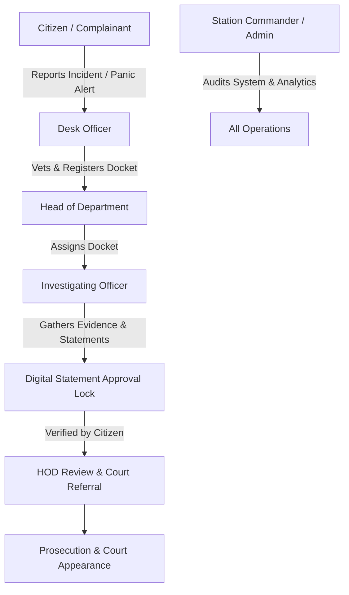

# 🛡️ Crime Administration System (CAS) & Emergency Dispatch

[](https://www.php.net/)
[](https://www.mysql.com/)
[](#)
[](https://opensource.org/licenses/MIT)

A mission-critical digital docket management and emergency dispatch system developed to modernize crime administration, incident reporting, and judicial workflow handling across administrative regions.

---

## 🎯 Impact & Problem Statement
Traditional paper dockets suffer from physical wear, misplacement risks, slow inter-station communication, and lack of real-time visibility for supervising officers. 

This platform digitizes the entire lifecycle of a criminal docket: from initial citizen reporting and GPS-tagged emergency dispatch, to investigative docket collation, HOD case assignment, statement verification locks, and court appearance scheduling.

---

## 👥 Multi-Tier Role Hierarchy



---

## ✨ Core System Capabilities

- 🚨 **Emergency Panic Dispatch:** Browser GPS capture with Euclidean proximity calculations to automatically assign and route incidents to the nearest police station under high-priority status.
- 🔒 **Statement Approval Lock:** Enforces procedural integrity—investigators cannot register warrants or progress notes until the complainant reviews and digitally signs their statement.
- 📁 **Digital Docket Management:** Secure evidence directory managing photographic, audio, video, and document evidence.
- 🔄 **Inter-Station Case Transfers:** Electronic case transfers between regional stations with full audit trails and reason logs.
- 🗺️ **GIS Scene Mapping:** Interactive **Leaflet.js** map rendering incident scenes, jurisdictions, and station boundaries without proprietary map API costs.
- 📄 **Digital Docket PDF Compiler:** Aggregates complainant profiles, statements, evidence logs, arrest details, and diary timelines into a standardized court-ready docket document.
- ⚖️ **Judicial Calendar:** Logs court dates, bail statuses, hearing outcomes, and docket archiving.

---

## 🏛️ Traditional Authority & Administrative Integration
Tailored to Eswatini's governance structure, capturing:
- **Administrative Regions:** Hhohho, Manzini, Shiselweni, Lubombo
- **Traditional Authority Details:** Chief (*Inkosi*) and *Indvuna*

---

## 💻 Tech Stack
- **Backend:** PHP 8.2+ (PDO with prepared statements, modular design)
- **Database:** MySQL 8.0+ / MariaDB
- **Frontend:** HTML5, CSS3, JavaScript (ES6+), Leaflet.js, Bootstrap
- **Security:** BCrypt password hashing, CSRF tokens, strict session role validation

---

## 🚀 Installation & Local Setup

1. **Clone or copy into web root:**
   ```bash
   git clone https://github.com/<your-username>/police-crime-administration-system.git
   ```
2. **Database Import:**
   - Create database: `eswatini_police_cas`
   - Import `database/schema.sql` via phpMyAdmin or MySQL CLI.
3. **Database Configuration:**
   - Review credentials in `config/database.php`.
4. **Access the System:**
   - Navigate to `http://localhost/eswatini-crime-system`.

---

## 📄 License
Released under the MIT License.
